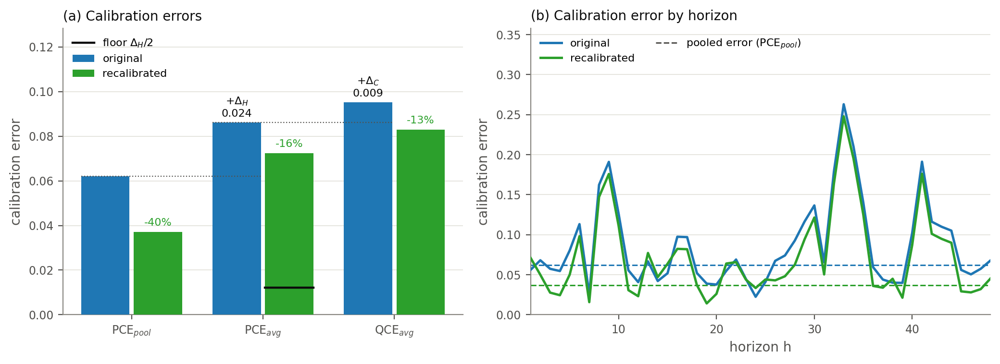

<h1 align="center">tsfm-calibration</h1>

<p align="center">
  Calibration evaluation and post-hoc recalibration for multi-horizon quantile forecasts,<br>
  accompanying the NeurIPS 2026 paper <a href="https://arxiv.org/abs/2611.03592"><i>Evaluating Uncertainty Calibration in Probabilistic Time Series Foundation Models</i></a>.
</p>

<p align="center">
  <a href="https://arxiv.org/abs/2611.03592"></a>
  
  <a href="LICENSE"></a>
</p>

Pooled coverage averages over all horizons and forecasts, so over- and undercoverage at different
horizons or predicted values can cancel. This package computes finer-grained calibration errors,
tests whether the resulting gaps are significant, and provides post-hoc recalibration.
<p align="center">
  
</p>

<sub>Chronos-2 on GIFT-Eval M_DENSE/H (30 series, 20 windows of 48 steps), isotonic recalibration fitted on the
earliest 20% of each series' windows; blue = original, green = recalibrated
(<a href="examples/readme_figure.py"><code>examples/readme_figure.py</code></a>).
<b>(a)</b> Error hierarchy; both gaps are significant (p = 0.001). The black tick marks Δ<sub>H</sub>/2, a lower bound
on PCE<sub>avg</sub> after any global recalibration map. <b>(b)</b> Calibration error at each horizon; dashed lines
are the pooled errors from (a). Recalibration lowers the pooled error by 40%, but large errors at single horizons remain.</sub>

## Metrics

With per-horizon coverage $p_h(\tau)=P(Y_h\le\hat q_{h,\tau})$ over quantile levels $\tau_1,\dots,\tau_Q$:

| Metric | Measures |
|---|---|
| $\mathrm{PCE}_{pool}=\frac1Q\sum_q\lvert\frac1H\sum_h p_h(\tau_q)-\tau_q\rvert$ | coverage averaged over horizons |
| $\mathrm{PCE}_{h}=\frac1Q\sum_q\lvert p_h(\tau_q)-\tau_q\rvert$ (avg / max over $h$) | coverage at each horizon |
| $\mathrm{QCE}_{h}=\frac1Q\sum_q\mathbb E\lvert P(Y_h\le\hat q_{h,\tau_q}\mid\hat q_{h,\tau_q})-\tau_q\rvert$ (avg / max over $h$) | coverage given the predicted value |

The estimators satisfy $\mathrm{PCE}_{pool}\le\mathrm{PCE}_{avg}\le\mathrm{QCE}_{avg}\le\mathrm{QCE}_{max}$.
The steps define the horizon gap $\Delta_H=\mathrm{PCE}_{avg}-\mathrm{PCE}_{pool}$ and the conditioning gap
$\Delta_C=\mathrm{QCE}_{avg}-\mathrm{PCE}_{avg}$.

Conditional coverage is estimated by isotonic regression of the hits $\mathbf 1\{y\le\hat q\}$ on $\hat q$ (no bins or
bandwidths). Its population target lower-bounds QCE and can miss decreasing or non-monotone patterns, so a small
value does not certify conditional calibration. 

## Install

```bash
pip install "tsfm-calibration[plot] @ git+https://github.com/thomdeck/tsfm-calibration"
```

Extras: `plot` (matplotlib), `chronos` (Chronos-T5 / Bolt / 2), `moirai` (Moirai 1.1 / MoE), `tirex`, `notebook`.
The core depends only on numpy, scipy, scikit-learn and pandas. Model weights and datasets carry their own licenses.

## Quickstart

**From existing forecasts:** targets `y (N, H)` and quantiles `qf (N, H, Q)`, with NaN for missing values.

```python
import numpy as np
from scipy.stats import norm
import tsfm_calibration as tc

rng = np.random.default_rng(0)
levels = [0.1, 0.2, 0.3, 0.4, 0.5, 0.6, 0.7, 0.8, 0.9]
mu = rng.normal(size=(500, 24, 1))
y = mu[..., 0] + rng.normal(scale=1.2, size=(500, 24))   # outcomes noisier than predicted
qf = mu + norm.ppf(levels)

print(tc.calibration_report(y, qf, levels))
# PCE_pool=0.0289 <= PCE_avg=0.0314 <= QCE_avg=0.0424 <= QCE_max=0.0600 | Delta_H=0.0025 Delta_C=0.0110 | ...
```

Sample paths `(N, S, H)` can be converted with `tc.samples_to_quantiles(samples, levels)`.

**End to end:** from a long-format DataFrame (one row per series and time step):

```python
series  = tc.from_dataframe(df, id_col="item_id", time_col="timestamp", target_col="target")
windows = tc.rolling_windows(series, prediction_length=48, num_windows=10)

f  = tc.forecast("chronos-2", windows)
ev = tc.evaluate(f, recalibrator="isotonic", tests=True)   # metrics, recalibration, gap tests
ev.summary()

from tsfm_calibration.plotting import plot_diagnostics
plot_diagnostics(f, ev).savefig("diagnostics.png")
```

The same is available on the command line:
`tsfm-calibration evaluate --model chronos-2 --csv data.csv --horizon 48 --tests`.
See [`examples/quickstart.py`](examples/quickstart.py) (synthetic data, CPU, seconds) and
[`notebooks/demo_custom_dataset.ipynb`](notebooks/demo_custom_dataset.ipynb) (the figure above, step by step).

## Custom models

Built-in wrappers (`tsfm-calibration models`): `chronos-t5-*`, `chronos-bolt-*`, `chronos-2`,
`moirai-{small,base,large}`, `moirai-moe-{small,base}`, `tirex`, `seasonal-naive`. Other models need one method:

```python
class MyModel(tc.Forecaster):
    name = "my-model"
    def predict_quantiles(self, contexts, prediction_length, levels):
        ...   # contexts: list of 1-D arrays (may contain NaN) -> array (B, H, Q)

f = tc.forecast(MyModel(), windows)
```

Plain functions can be wrapped with `tc.FunctionForecaster(fn)`, and `tc.compare({"a": f_a, "b": f_b})` evaluates
several models on their common windows. Moirai needs the data frequency, e.g. `forecast("moirai-small", windows, freq="D")`.

## Significance tests

Estimated gaps can be positive by chance. Both tests resample whole series, preserving dependence within a series:

```python
dc = tc.delta_c_test(f.y, f.qf, f.levels, f.series_ids, f.window_indices)  # H0: coverage independent of predicted value
dh = tc.delta_h_test(f.y, f.qf, f.levels, f.series_ids)                    # H0: equal coverage at all horizons
dc.p_value, dc.corrected                                                   # corrected = gap minus null mean
```

`delta_c_test` permutes hit trajectories among series with the same number of windows; `delta_h_test` is a
series-cluster bootstrap. Both assume independent series, which may not hold for channels of a multivariate
process. If a test cannot be run (e.g. a single series), it returns `available=False` with a `reason`.

## Recalibration

```python
cal, test = f.chronological_split(cal_fraction=0.2)    # earliest 20% of each series' windows
rec = tc.get_recalibrator("isotonic").fit(cal.y, cal.qf, cal.levels)

tc.calibration_report(test.y, test.qf, rec.relabel(f.levels))   # relabeled levels, as in the paper
qf_new = rec.transform(test.qf, test.levels)                     # quantiles at the original levels
```

Available maps: `isotonic` (Kuleshov et al., 2018), `platt`, `histogram_binning`, `kde` (Dheur & Ben Taieb, 2023).
A single global map can remove pooled error, but cannot bring $\mathrm{PCE}_{avg}$ below $\Delta_H/2$ of the original
forecasts, and it may increase $\mathrm{QCE}_{avg}$. Report $\mathrm{PCE}_{avg}$ and $\mathrm{QCE}_{avg}$ on held-out
windows, not only pooled coverage. For external forecasts, make sure calibration targets are observed before the
first test forecast origin.

## GIFT-Eval

GIFT-Eval is installed from source, separately from this package:

```bash
git clone https://github.com/SalesforceAIResearch/gift-eval.git
git -C gift-eval checkout 5acf27d8befc3d6d9dbed5057ada3588d1d6cfab
pip install -e ./gift-eval
hf download Salesforce/GiftEval --repo-type dataset --local-dir /path/to/gift-eval-data
export GIFT_EVAL=/path/to/gift-eval-data
```

[`examples/gift_eval.py`](examples/gift_eval.py) applies the full pipeline to GIFT-Eval configurations via
`tc.gift_eval_windows()`. Multivariate datasets are split channel-wise.

## Citation

```bibtex
@inproceedings{decker2026evaluating,
  title     = {Evaluating Uncertainty Calibration in Probabilistic Time Series Foundation Models},
  author    = {Decker, Thomas and Tresp, Volker},
  booktitle = {Advances in Neural Information Processing Systems},
  year      = {2026},
  eprint    = {2611.03592},
  archivePrefix = {arXiv},
  url       = {https://arxiv.org/abs/2611.03592}
}
```
